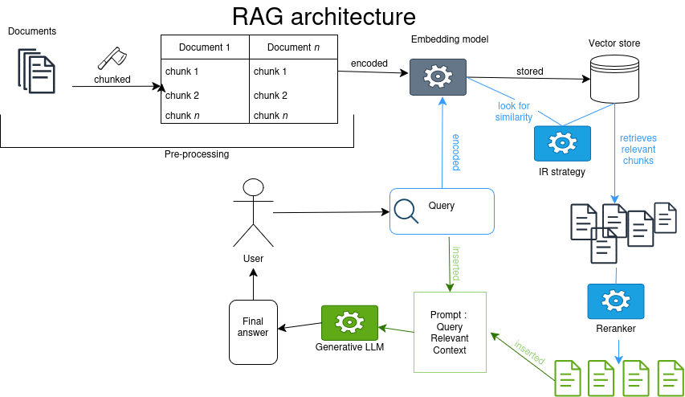
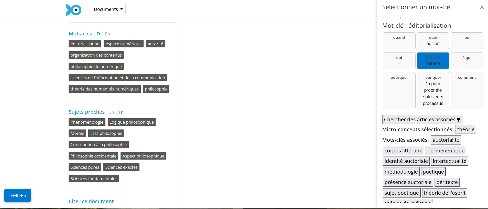
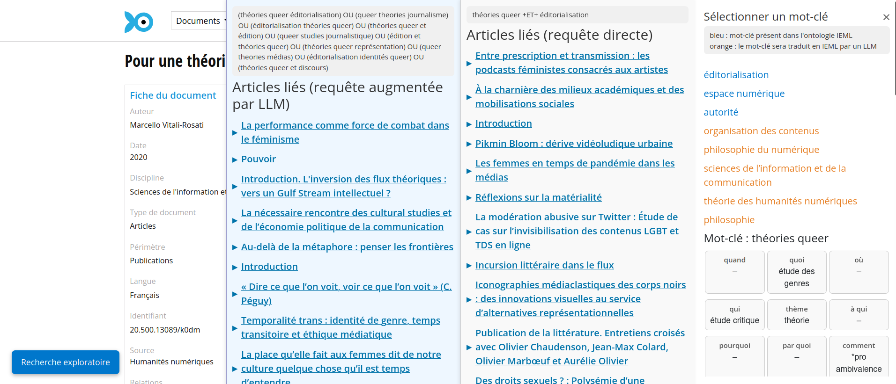
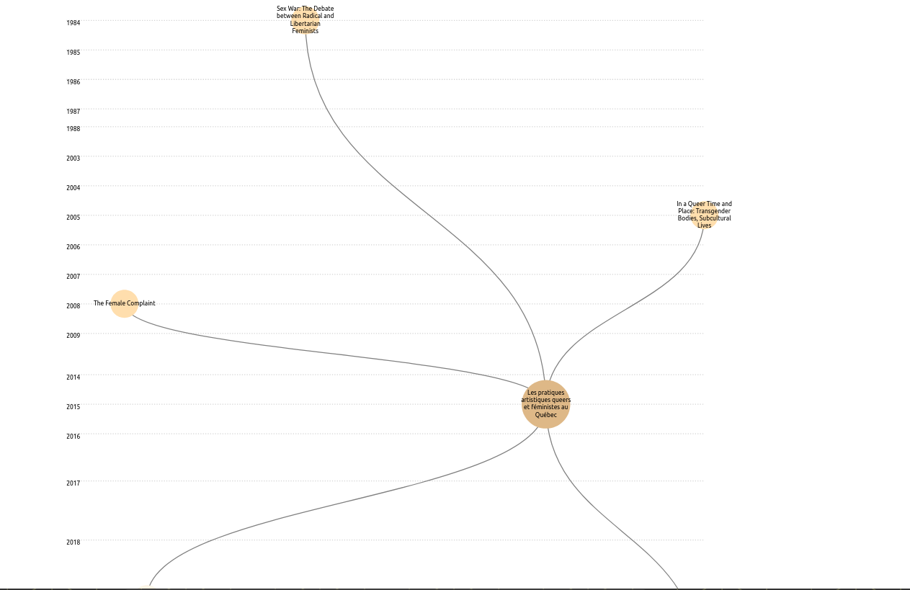
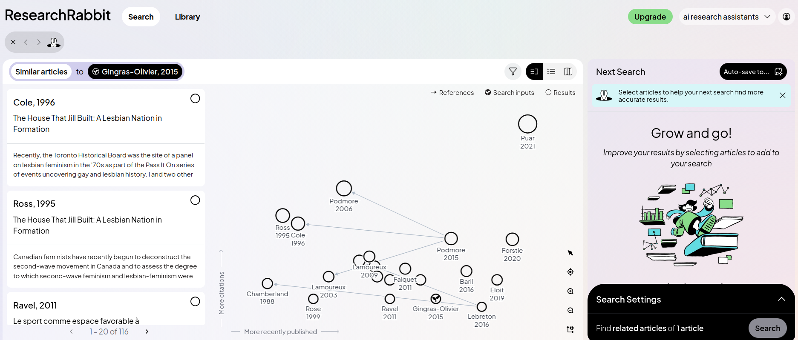
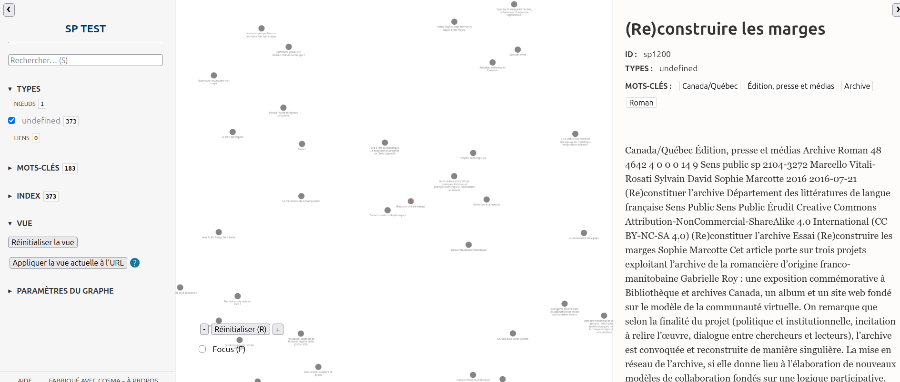

# Présentation du laboratoire et des recherches en cours

## Le laboratoire et Revue3.0

Marcello Vitali-Rosati en 2015 à l'Udem constitue une cellule de recherche sur l'éditorialisation, puis sur les usages du numérique pour l'édition scientifique et notamment l'écriture savante. Approche philo plus que littérature. 

2024 Revue3.0, projet de partenariat (Érudit, Huma-Num, OpenEdition, Zotero) incluant des revues en SHS: 

Louis-Olivier : 8 ans de collaboration avec MVR, direction. intérêts de recherche : le post-humain en littérature, et intérêt pour l'outil technique dans une approche low-tech/retro-computing. 

Alexia : arrivée en 2025 pour travailler sur l'IA, notamment pour développer un outil exploitant IEML, qui deviendra IEML-RS. Sujet prend un tournant plus théorique sur la question des pratiques de l'IA générative pour la recherche documentaire en contexte scientifique. 

## Revue3.0 

Quelques projets actuels qui peuvent intéresser érudit: 

1. Référentiel des pratiques des revues 
<!-- LOB -->
<!--  -->
<!--  -->

2. Projet sur les pratiques de découvrabilité 

Entretiens des revues partenaires (en SHS). Typologie des stratégies employées. 

3. Reflexion sur l'adoption de déclaration d'usage de l'IA pour les auteur.ices auprès des revues

<!-- 
Focal sur quelques projets qui peuvent intéressés les personnes présentes. 
    - 
    - Projet sur les pratiques éditoriales non documentées des revues
    - 
    - Reflexion transversales sur les outils de découvrabilité  -->

## Problématiques liées à l'IA pour le 'futur d'érudit'

Situation d'érudit ?
- érudit devenu simple dépôt exploité par les robots des produits IA -> bloquer l'accès ?
- proposer ses propres outils pour la recherche documentaire basée sur des requêtes en langue naturelle (RAG) ?
- enrichissement et structuration automatique des articles ? -> utilisation du plain texte vs. données structurées ?

## Les enjeux

2 Questions :

- Côté diffuseur :  Pertinence de la structuration des données (faite manuellement) ?
- Côté chercheur..ses : Nouveaux modes d'appropriation de vastes jeux de données 

# Automatisation de la structuration sémantique 

## La question de l'enrichissement sémantique 

**Intérêt pour les chercheur..ses et pour les revues**

<!-- 
From Tully Barnett DHSI institute lecture 26-06-08
Metadata : 

- is interpretation
- schemas shape interpretation -> you can delegate interpretation to it, can be positive if well thought out or negative if it depossesses you of that thought process.
- categories shape knowledge
- classification structures thought -->

Simon van Bellen (Érudit), “Do Scholarly Article Views Reflect a “Social Impact” of SSH Research? Analyzing Users and Usage Patterns of Érudit’s Collections” 

Presence of abstracts impacts after year 1 the number of downloads.

## Les avenues explorées pour le pré-traitement

1. La structuration sémantique des données bibliographiques dans un mode Single Source Publishing 

Ex: passage de Zotero à une bibliographique stylée = perte d'informations sémantiques

<!-- LOB -->

2. Intérêt d'avoir du BibTeX ou format bibliographique (RDF, CSL) et/ou XML-TEI ou XML-érudit avec métadonnées riches 

![Screenshot]

Question : qui doit ou peut produire ces données structurées ? 

## Structuration par application à base de LLM 

Les modèles specialisé pour al structuration de la bibliographie sont imparfaits, pourtant les applications grand public (des système agentique à base de LLM) sont très performants. 

<!-- screenshot test sur un article SP  -->

Une inévitabilité ? 

Produit une bibliographie structurée en XML-TEI, identifie des erreurs dans la bibliographie qui a été corrigée manuellement. 

# Questions ?

# De nouvelles formes d'appropriation de la littérature savante 

## Rappels sur les RAG

La tendance actuelle est au RAG : Retrieval Augmented Generation ou Recherche Augmentée par Génération. 

Forces et faiblesses: 
- Nécessite accès au texte brut -> pré-traitement important (chunking, vectorisation)
- Dimension persuasive des synthèses générées, délégation cognitive etc. 
- Paradigme de la trouvabilité (vs. découvrabilité incluant sérendipité)
- Amalgame des questions de recherche (ex: quoi, pourquoi, quand). 

## Alternatives aux chatbots pour l'exploration de vaste corpus 

Conception d'outils de recherche alternatifs: 
recherche par mots-clés dans un espace sémantique déterminé + exploration par relation sémantique +/- explicitées 

Ex 1: IEML-RS

Ex 2 : Flux RSS 

Force et faiblesse: 
- conception à rebours des interfaces sans friction, 
- renouvelle l'implication des chercheur..ses. 
- Pas d'application de grande échelle, application limitée par les termes annotés (limite de l'automatisation pour la structuration sémantique à ce niveau de granularité), appropriation difficile, intégration aux pratiques très peu probable.

## Visualisation par graphe de réseaux: 

Force et faiblesse:
- Visualisation et navigation favorise les démarches exploratoires
- Pas toujours évident d'expliciter les liens entre les noeuds 
- Limite fine entre pistes nouvelles et bruit (le graphe devient une masse)

ex: citation tree 

ex: research Rabbit

ex: Démo [Cosma](https://cosma.arthurperret.fr/) pour exploration à partir de la biblio ou des mots-clés (controlés, Rameau)

## Quelles alternatives ? Quelles demandes de la part des utilisateur.ices ? 

- Quelles seraient les outils de mises à disposition de la connaissance de la recherche pour vous ? 
- Quelle est votre utilisation des assistants de recherche IA ? 
- Est-ce que ça vaut le coup de structurer des données ? De développer des outils hors RAG ? 

